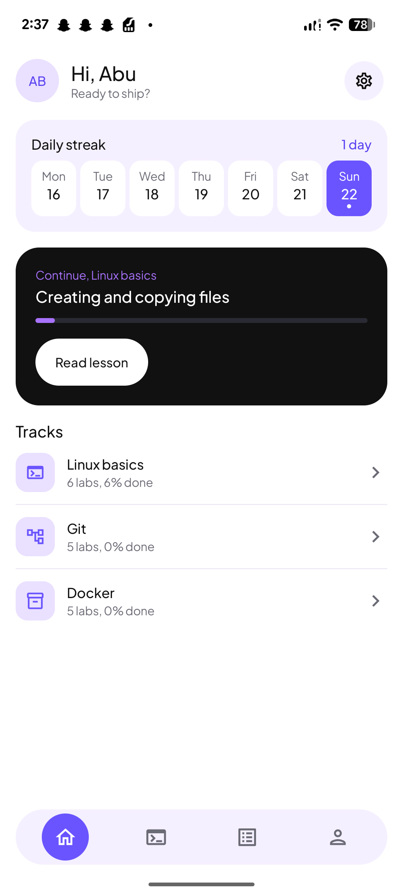
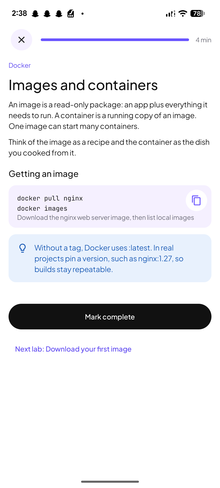
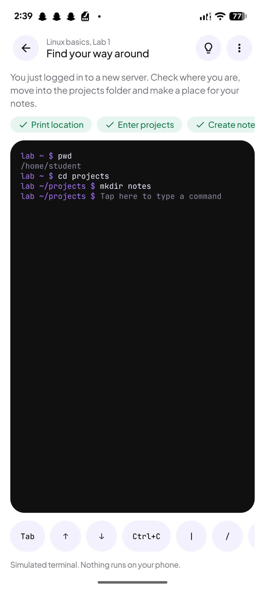
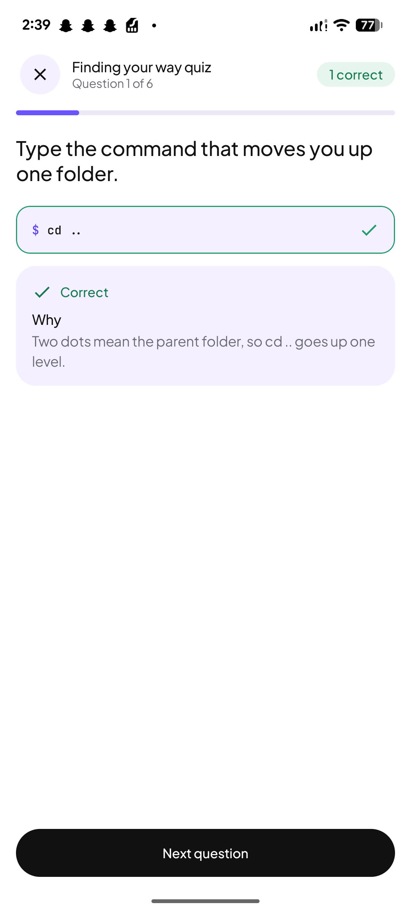
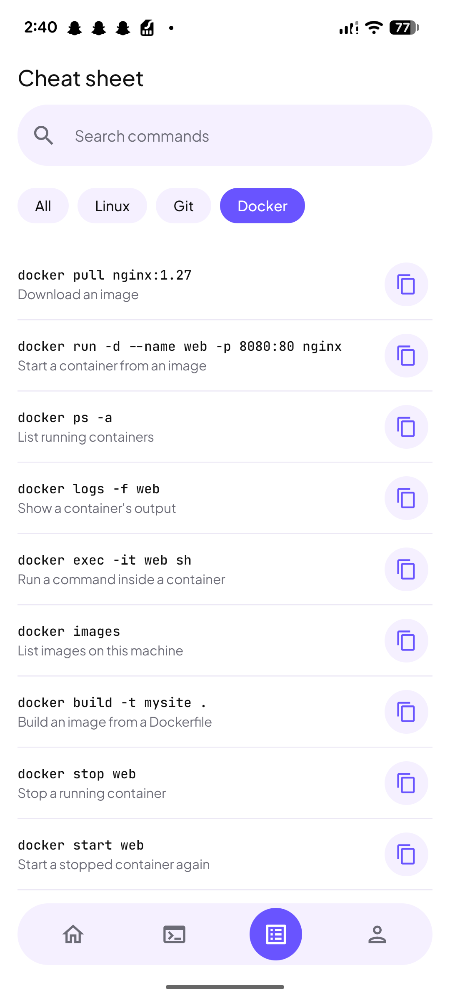
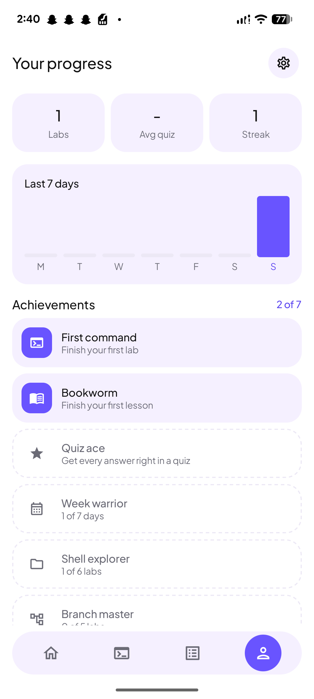
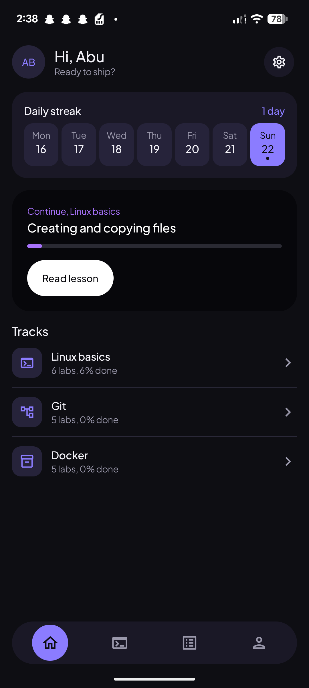
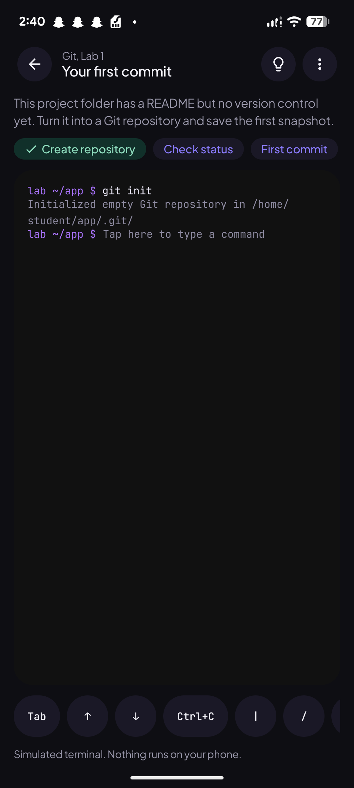
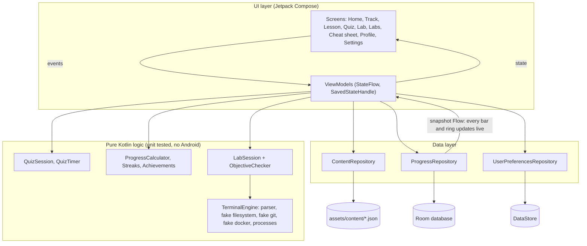

# RocketDevOps Mobile

A free Android app, fully usable offline, for learning **Linux, Git and Docker** with short lessons,
live quizzes and hands-on labs in a **simulated terminal**. Mobile companion to
[rocketdevops.vercel.app](https://rocketdevops.vercel.app).

> **The terminal is simulated.** Commands are interpreted by an in-app simulator that works on
> an in-memory fake filesystem, a fake Git repository and a fake Docker daemon. Nothing is ever
> executed on your phone, and no command ever leaves it.

Built as a university course project with Kotlin and Jetpack Compose.

**Download:** the latest APK is on the [Releases page](../../releases/latest) (Android 8.0 or newer).

## Screenshots

| Home | Track | Lab | Quiz |
|---|---|---|---|
|  |  |  |  |

| Cheat sheet | Profile | Home (dark) | Lab (dark) |
|---|---|---|---|
|  |  |  |  |

## Features

- **3 tracks, 13 modules:** 17 lessons, 50 quiz questions and 16 labs. Linux (navigation, files,
  permissions, grep and pipes, processes, shell scripts), Git (commits, staging, history, branches,
  merging, a real merge conflict) and Docker (images, run, logs and exec, ports, volumes, Dockerfiles).
- **Labs in a simulated terminal:** objectives tick green as you work, three levels of hints,
  Tab completion, command history, quick keys and realistic error messages.
- **Live quiz:** multiple choice, true or false and "type the command". Instant feedback with an
  explanation, retry only the wrong ones, optional 30-second timer.
- **Live progress:** daily streak, track and module progress, last-7-days chart and 7 achievements.
  Everything updates the moment a lesson, quiz or lab is finished.
- **Cheat sheet:** 80 commands with search, category chips, flags and tap-to-copy.
- **Settings:** your name, light or dark theme, text size, quiz timer and Reset progress
  (with an option to start again at the Welcome screen for the next person at an exhibition).
- **Optional account (free Firebase plan):** sign in with email and password and your lessons,
  labs, quiz scores, streak and achievements are saved online. Sign out or reinstall, sign in again
  on any phone, and everything is back exactly as you left it. Guest progress made before signing
  in is merged, never lost. Without an account the app works fully offline, as before.
- **Smooth motion:** Material 3 shared-axis transitions between screens, fade-through between tabs,
  content that eases in, numbers that roll up when progress changes, and press feedback on buttons.
  All of it turns off with Android's "Remove animations" setting.
- **Accessible:** TalkBack labels, 48 dp touch targets, AA colour contrast, works at font scale 1.3.

## Architecture

MVVM with one-way data flow. Screens are stateless composables; ViewModels expose `StateFlow`;
repositories are the single source of truth. Dependencies are created by hand in `AppContainer`
(the spec allows manual DI instead of Hilt).



### How the simulated terminal works

```
typed text -> Tokenizer -> CommandParser -> TerminalEngine -> command handler -> output lines
                                               |       (LinuxCommands, ProcessCommands, GitCommands, DockerCommands)
                                               +-> VirtualFileSystem, ProcessTable, GitRepository, DockerDaemon (all in memory)
after each command: ObjectiveChecker ticks the lab objectives (LabSession)
```

Every command is Kotlin code that changes in-memory objects. The engine is deterministic (no clock,
no randomness), so a lab is rebuilt exactly after Android closes the app, by replaying the typed commands.

### Where data lives

| Data | Storage | Why |
|---|---|---|
| Lessons, quizzes, labs, cheat sheet | JSON in `assets/content` | Content can be added without changing Kotlin code ([format](docs/content-format.md)) |
| Finished items, quiz attempts, daily activity, achievements | Room | Queried and observed as Flows, survives restarts |
| Name, theme, text size, quiz timer | DataStore (Preferences) | Small key-value settings |
| Screen state during rotation or process death | ViewModel + SavedStateHandle | Quiz answers, lab commands, search text |
| Copy of a signed-in learner's progress | Cloud Firestore, one document `users/{uid}` | Comes back after sign-out, reinstall or on another phone ([setup](docs/firebase-setup.md)) |

Room stays the single source of truth for every screen. While signed in, each change is copied
online about 2 seconds later; signing in merges the phone's progress with the online copy
(finished items and achievements are a union, daily activity takes the larger count), so nothing
earned is lost. Security rules ([firestore.rules](firestore.rules)) let each learner read and
write only their own document.

## Tech stack

Kotlin 2.1, Jetpack Compose (BOM 2024.12), Material 3, Navigation Compose, Lifecycle ViewModel,
Room 2.6 (KSP), DataStore Preferences, kotlinx.serialization, Firebase Authentication and
Cloud Firestore (BoM 34, free Spark plan). Min SDK 26, target SDK 35.
No paid services, no analytics, no ads. The internet is used only by the optional account.

## Open, run and test

1. Install the latest stable Android Studio (it bundles a JDK; Gradle uses JDK 21).
2. File > Open, choose this folder and let Gradle sync.
3. Run the `app` configuration on a phone or emulator (Android 8.0 or newer).
4. Optional, for accounts: follow [docs/firebase-setup.md](docs/firebase-setup.md) to put
   `app/google-services.json` in place. Without it the app builds and runs in guest-only mode.

```
.\gradlew.bat :app:testDebugUnitTest          # 203 unit tests, no phone needed
.\gradlew.bat :app:connectedDebugAndroidTest  # 11 Compose UI tests, needs a phone or emulator
.\gradlew.bat :app:assembleRelease            # release APK in app/build/outputs/apk/release/
```

On macOS or Linux use `./gradlew` instead of `.\gradlew.bat`.

What the tests cover: the tokenizer and parser, every Linux, Git, Docker and process command,
pipes and redirects, every lab's solution (each lab is played in the simulator and must finish),
content validation of every JSON file, quiz rules and the timer, streaks, achievements and progress
maths, the Room repository (with a fake DAO), account sync (sign in and out, merging, no internet,
reset; Firebase replaced by fakes), colour contrast, and UI tests for the quiz, cheat sheet,
Welcome and Settings screens. Before a release, also run the
[manual test checklist](docs/manual-test-checklist.md).

## Project layout

```
app/src/main/java/com/rocketdevops/mobile/
  MainActivity.kt          single activity: theme and text size from DataStore
  AppContainer.kt          manual dependency injection (repositories, Room, DataStore)
  navigation/              routes and the navigation graph
  data/content/            content models, JSON loader, validator, repository
  data/progress/           ProgressRepository, Room database, streak / achievement / progress logic
  data/prefs/              user settings in DataStore
  data/sync/               optional accounts: merge rules, Firestore format, Firebase gateway
  terminal/                the simulated terminal and the lab objective checker
  ui/theme/                ALL design tokens: colour, type, shape, spacing, motion
  ui/components/           shared stateless components, each with light and dark previews
  ui/<screen>/             one folder per screen: ViewModel, screen, pure state builder
app/src/main/assets/content/  lessons, quizzes, labs and cheat sheet as JSON
app/src/test/              JVM unit tests
app/src/androidTest/       Compose UI tests
docs/                      content format, manual checklist, demo script, release guide
```

**Design rule:** colours, dp, sp and corner radii appear only in `ui/theme/`. Screens read tokens
(`AppTheme.colors.surface`, `Spacing.md`, `AppShapes.card`), so light and dark mode stay consistent.

## Limitations

- The terminal is a **simulator**, not a real shell. It supports the commands the labs need
  (type `help` in any lab to list them) and a subset of their flags. There is no text editor:
  files are written with `echo` and `>`.
- Git has no remotes (`push`, `pull` and `clone` explain this). Docker volumes and networks are
  accepted in commands but not simulated.
- Content is small: enough for a first course, not a full curriculum.
- Accounts need the internet to sign in, sign out and sync. Offline changes are saved when the
  connection returns; signing out offline asks first, because unsaved progress would be lost.
- Sign-in is email and password only (phone/SMS sign-in costs money on Firebase).
- English only. The release APK is signed with the debug key, which is fine for sharing from
  GitHub but not for the Play Store.

## Future work

- A richer shell for the Linux track (variables, `for` loops, `if`) and more commands.
- More tracks: Kubernetes, CI/CD pipelines and cloud basics, matching the website.
- Content packs downloaded from the website, with the same JSON format and validator.
- Spaced-repetition review of wrong quiz answers.
- Urdu translation of the lessons.
- A pilot study with students to measure learning gains.

## Fonts and licences

Plus Jakarta Sans and JetBrains Mono, both under the SIL Open Font License 1.1
(licence texts in `licenses/`). Bundled as Latin-subset TTF files so text renders offline.
Icons are Material Symbols (Apache 2.0) through `material-icons-extended`.
